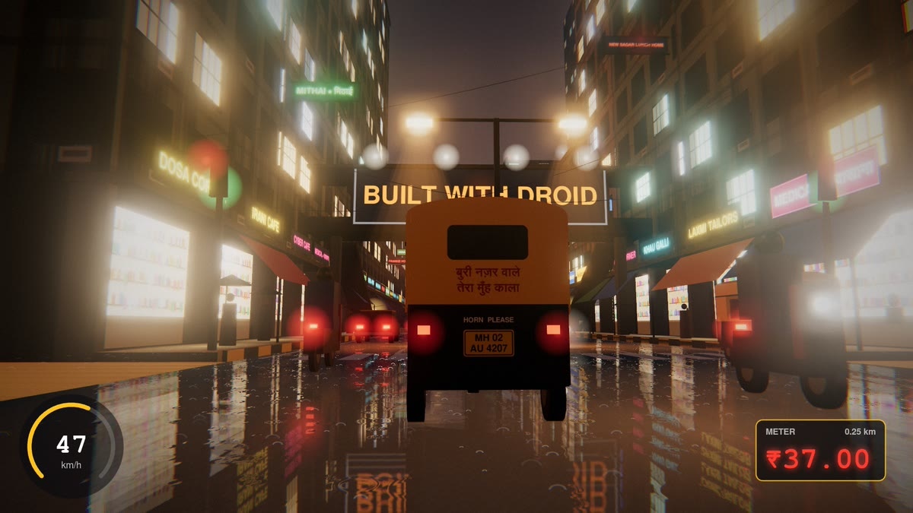

# Mumbai Monsoon

Drive an auto-rickshaw through Mumbai at midnight in monsoon rain. The whole game is one HTML file: every sign, texture, raindrop and sound is generated by code. There are no images, 3D models or audio files. The only library is three.js.

Built with [Droid](https://factory.ai).

**▶ Play: https://karanchoudharyyt-source.github.io/mumbai-monsoon/**



**Video:** [mumbai-monsoon.mp4](https://github.com/karanchoudharyyt-source/mumbai-monsoon/releases/latest/download/mumbai-monsoon.mp4) (1080p, 38 s, with sound) · [cockpit clip](https://github.com/karanchoudharyyt-source/mumbai-monsoon/releases/latest/download/mumbai-monsoon-cockpit.mp4) · [all downloads](https://github.com/karanchoudharyyt-source/mumbai-monsoon/releases/latest)

## Controls

| | Phone | Laptop |
|---|---|---|
| Drive | hold **GAS** | **W** / **↑** |
| Brake | **BRAKE** | **S** / **↓** |
| Steer | **◀ ▶** | **A D** / **← →** |
| Horn | **HORN** | **H** |
| Camera (chase, cockpit, cinematic) | **CAM** | **C** |
| Autopilot | **AUTO** | **P** |

Try the cockpit camera. The wipers work.

## What's in the file

- A Mumbai street: lit windows with curtains, rolling shutters, neon shop signs in English and Hindi, water tanks and billboards on the roofs, sagging cables, lamps and yellow-and-black kerbs. All of it is painted onto canvases when the page loads.
- A wet road with real reflections, rain ripples and splashes. Rain streaks are lit by the headlights and street lamps, and lightning flashes the sky.
- The auto has a canvas hood, "बुरी नज़र वाले तेरा मुँह काला" painted on the back, an MH plate and a driver in khaki. Traffic includes autos, kaali-peeli taxis, cars, buses, trucks and bikes.
- A speedometer and a red fare meter that starts at ₹26.
- Rain, engine and horn sounds made with the Web Audio API.

`og.jpg` is only the link-preview image. The game itself loads nothing except three.js.

The prompt to build your own is in [PROMPT.md](PROMPT.md).

## Repo layout

- `index.html` is the game, built from `src/` by `build.sh`. Don't edit it by hand.
- `src/` holds the source parts (`1-core.js` … `7-run.js`), which are joined in order inside `head.html` / `tail.html`.
- `grab.js` and `render-all.sh` render the cinematic cut (`?demo`) frame by frame in headless Chrome.
- `audio.js` synthesizes the video soundtrack: rain, hood patter, engine, horns, wipers and thunder, all timed to the render.
- `encode.sh` masters the audio and encodes the MP4s.
- `probe.js` scores camera rigs by how often traffic blocks the view.
- `touch-test.js` is a smoke test for phone (landscape and portrait) and desktop.

## Build and render

Needs Node 18+, Google Chrome, Python 3 and ffmpeg.

```sh
npm install
npm run build          # index.html + render.html
npm run serve          # keep running in another terminal (http://127.0.0.1:8765)
npm run test:touch     # optional smoke test, screenshots in touch-shots/
npm run render         # 1080 frames into frames/ (slow on CPU: about 4-12 s per frame)
npm run audio          # soundtrack.wav, timed from demo-info.json written by the render
npm run encode         # out/mumbai-monsoon.mp4, -plain.mp4, -cockpit.mp4
```

Set `CHROME=/path/to/chrome` if Chrome isn't at `/usr/bin/google-chrome`. The render is deterministic: the same seed gives the same frames.
